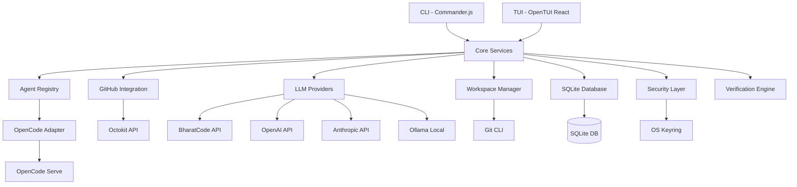
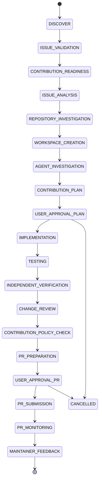

# OSSPilot Architecture Documentation

## System Overview

OSSPilot is a local-first CLI + TUI application for open-source contribution management.



## Component Responsibilities

### CLI (`src/cli/`)
- Commander.js command definitions
- Argument parsing and validation
- Output formatting
- Entry points for all user commands

### TUI (`src/tui/`)
- OpenTUI React components
- Layout management (panels, sidebar, composer, status bar)
- Keyboard navigation
- State management (Zustand)
- Polls database for live updates

### Core (`src/core/`)
- `ContributionManager` — state machine, persistence, pause/resume/cancel
- `Doctor` — environment health checks
- `Errors` — OSSPilotError with codes and hints

### Agents (`src/agents/`)
- `AgentAdapter` interface — provider-independent contract
- `AgentRegistry` — registration and lookup
- `OpenCodeAdapter` — OpenCode server spawn, session management, execution

### Integrations (`src/integrations/`)
- `github/` — Octokit client, auth, device flow, preflight, PR management
- `bharatcode/` — Intelligence service (LLM-powered)
- `llm/` — Multi-provider LLM registry (OpenAI, Anthropic, Ollama, etc.)

### Workspace (`src/workspace/`)
- `RepositoryManager` — clone, fetch, default branch
- `WorktreeManager` — create/remove worktrees, diff, changed files, commit

### Storage (`src/storage/`)
- `database/client.ts` — SQLite connection + migrations
- `database/schema.ts` — Drizzle schema (9 tables)
- `cache.ts` — Response cache (SQLite key_value)

### Security (`src/security/`)
- `credentials.ts` — OS keyring + encrypted file + env var
- `crypto.ts` — AES-256-GCM encryption
- `policy.ts` — Command classification (allow/approval/deny)
- `audit.ts` — Audit log writer

### Verification (`src/verification/`)
- `engine.ts` — Independent verification (diff, tests, lint)

### Config (`src/config/`)
- `paths.ts` — Directory layout, restrictive permissions
- `settings.ts` — Zod-validated user config

### Logging (`src/logging/`)
- `logger.ts` — Structured logging with sanitization

## Data Flow

```
User → CLI/TUI → Command/Component → Core Service → Integration/Workspace/Storage
                                                              ↓
                                                    Database (SQLite)
                                                    GitHub API (Octokit)
                                                    LLM API (OpenAI SDK)
                                                    OpenCode Server
                                                    Git CLI
```

## Authentication Flow

```
User → osspilot config auth github
  → Device flow (browser) or env var or gh CLI bootstrap
  → Token stored in OS keyring (keytar)
  → Fallback: encrypted file (AES-256-GCM)
  → Fallback: environment variable
```

## LLM Provider Flow

```
User config → LLMProviderRegistry.fromConfigs()
  → Provider instances (BharatCode, OpenAI, Anthropic, etc.)
  → IntelligenceService(provider)
  → provider.chat() or provider.structuredOutput()
  → LLM API call
```

## OpenCode Execution Flow

```
contribute command → OpenCodeAdapter.startSession(worktreePath)
  → spawn opencode serve (port, password from stdout)
  → POST /api/session (create session)
  → POST /api/session/{id}/prompt (send prompt)
  → Poll GET /api/session/{id}/message (get response)
  → Yield message.delta events
  → session.completed
```

## Database Architecture

9 tables:
- `contributions` — aggregate root (repo, issue, stage, worktree, PR)
- `contribution_events` — event journal (stage transitions, approvals, errors)
- `agent_sessions` — OpenCode session tracking
- `workspaces` — worktree metadata
- `test_results` — test execution records
- `review_reports` — verification reports
- `pull_requests` — PR records
- `key_value` — generic cache/metadata
- `audit_log` — security audit trail

## Security Architecture

```
User Input → Validation (Zod/regex) → Policy Check (classifyCommand) → Execution
                                            ↓
                                    Denied → Error
                                    Approval → Prompt User
                                    Allowed → Execute
```

Credential storage chain:
```
OS Keyring → Encrypted File (AES-256-GCM) → Environment Variable
```

## Mermaid: Contribution Lifecycle

