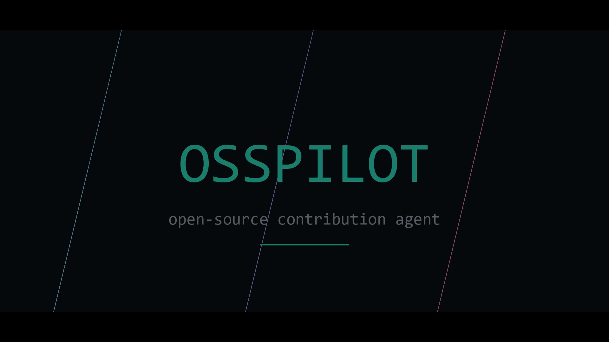
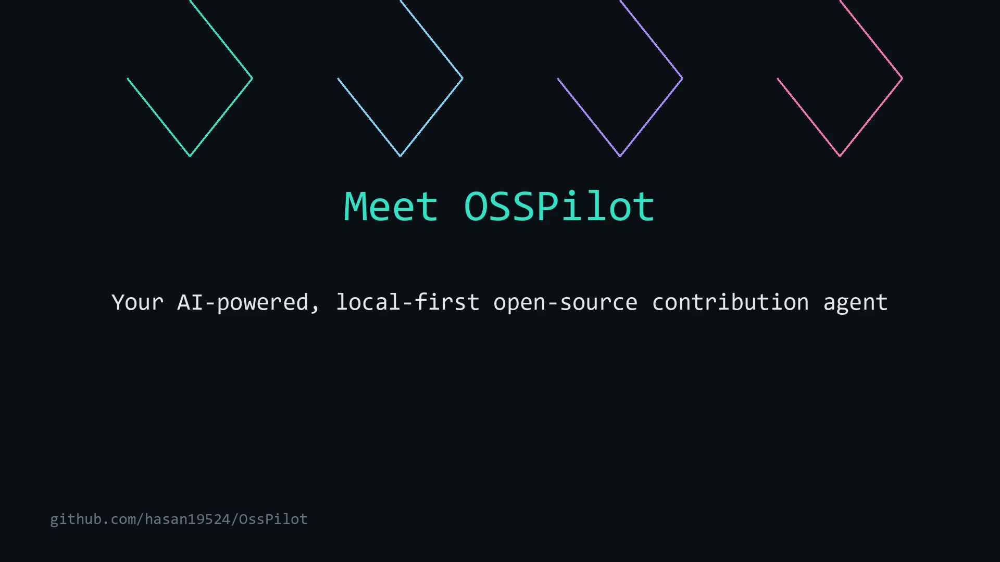

# OSSPilot

<p align="center">
  
</p>

A terminal-native AI assistant that helps developers discover open-source
projects, understand issues, and organise contribution workflows.

OSSPilot runs locally in your terminal: it talks to the GitHub API, inspects
code you have cloned, prepares contribution plans, and hands implementation to
a coding agent inside an isolated Git worktree — but nothing is committed,
pushed or opened as a pull request without your explicit approval.

> **Project status:** prototype / development stage. Core discovery, research,
> inspection and planning are implemented and verified against the live GitHub
> API; the implementation and verification stages of the workflow are
> implemented and tested, with known limitations. See
> [`docs/limitations.md`](docs/limitations.md).

---

## Overview

Finding a good open-source contribution is harder than it looks. There are
millions of repositories and issues, the interesting ones are rarely labelled
"beginner", and a repository that welcomes contributions still may not be a
good match for what you know or want to work on. Understanding an unfamiliar
codebase takes time, and the contribution conventions of each project differ.

OSSPilot approaches this from the terminal you already work in:

1. **Discovery** — search GitHub for repositories with contribution
   opportunities, not just stars.
2. **Research** — pull repository health, issue intelligence and a suitability
   assessment for a specific issue.
3. **Inspection** — inspect the actual code you have cloned (languages, layout,
   tests, conventions, recent history).
4. **Planning** — produce a contribution plan scoped to one issue.
5. **Approval-gated implementation** — clone into an isolated worktree and
   delegate to OpenCode with your AI provider, stopping at every gate.
6. **Verification** — run the project's own test command in the worktree before
   anything is proposed for review.

It is **local-first**: your credentials stay in the OS keyring or environment
variables, repositories and worktrees live under `~/.osspilot`, and every
network call is to GitHub or the AI provider you configured. No service is
required to run OSSPilot itself.

## Watch

GitHub does not render inline video in README files, so each clip is a clickable
poster frame — the video opens in your browser's player.

| 30-second intro — points and score | 50-second product explainer — real product output |
|---|---|
| [](https://github.com/hasan19524/OssPilot/raw/main/artifacts/videos/osspilot/OSSPilot_30s_Intro.mp4) | [](https://github.com/hasan19524/OssPilot/raw/main/artifacts/videos/osspilot/OSSPilot_50s_Product_Explainer.mp4) |
| The problem → what OSSPilot does → the guarantees: local-first, verifiable, approval-gated. No application footage. | Title cards and terminal screens of real application output: discovery, research, inspection, planning, the approval gate and status. Narration script: [`OSSPilot_Subtitles.srt`](artifacts/videos/osspilot/OSSPilot_Subtitles.srt). |

Both files also live in [`artifacts/videos/osspilot/`](artifacts/videos/osspilot).

---

## Features

Legend: **verified** = exercised against real services on Windows (see
[`docs/verification/acceptance-matrix.md`](docs/verification/acceptance-matrix.md));
**implemented** = present and unit/integration tested, not exercised end-to-end
live.

| Feature | Status | Notes |
|---|---|---|
| GitHub repository discovery (search + open-issue listing) | verified | live `/discover`, `osspilot discover` |
| Issue discovery and research (health score, issue intelligence, suitability) | verified | live `/research`, `osspilot research` |
| Repository inspection of cloned code | verified | live `/explain`, `osspilot research --no-clone` disables it |
| Contribution planning for one issue | verified | live `/plan` |
| Human approval workflow (plan gate, PR gate) | verified (reject) / implemented (approve) | reject path exercised live; approve path covered by tests |
| Isolated Git worktrees | verified | real clone + branch per contribution |
| OpenCode integration (session, permissions, streaming output) | verified | real provider call ran to completion |
| Independent verification of changes | implemented | verification engine + test-command detection; not part of a live approve-to-PR run |
| Session and conversation history (persisted) | verified | transcript survives restart |
| Multiple AI providers (BharatCode, OpenAI, Anthropic, OpenCode-configured) | implemented | provider detection unit-tested; BharatCode verified via `doctor` |
| Natural-language intent routing (no LLM required) | verified | greetings, find/research/explain/plan/status |
| Cooperative cancellation | verified | `Ctrl+C` stops work at the next safe point |
| Coding agent status honesty (`NOT_INSTALLED`, `NOT_AUTHENTICATED`, `IDLE`, …) | verified | provider config read without exposing secrets |

Planned, not implemented: cross-platform runtime validation beyond Windows,
worktree reuse across sessions, richer issue ranking.

---

## Architecture

```
              +--------------------------------------------+
              |                  TUI (OpenTUI + React)      |
              |  conversation | agents | history  composer |
              +--------------------+-----------------------+
                                   | structured dispatch results
                                   v
              +--------------------------------------------+
              |            Intent layer (deterministic)     |
              |   greetings/thanks/identity + workflow      |
              |   rules -> slash-command equivalent         |
              +--------------------+-----------------------+
                                   |
       +---------------------------+---------------------------+
       v                           v                           v
 GitHub client (Octokit)    Inspection engine           Contribution runner
 - search repos             - languages, layout        - pre-flight checks
 - issues, comments         - tests, conventions       - worktree + branch
 - project health           - contribution rules       - agent session
 - rate-limit awareness     - recent history           - approval gates
       |                                                     |
       v                                                     v
 SQLite (drizzle + better-sqlite3)            OpenCode adapter (HTTP API)
 - sessions, messages                        - session lifecycle
 - contributions, events                     - permission handling
 - reviews, test results                     - honest state reporting
```

Stack at a glance: TypeScript on Bun; OpenTUI + React for the terminal UI;
SQLite with drizzle-orm and `better-sqlite3`; Octokit for GitHub; `keytar` for
credential storage; `zustand` for TUI state; commander for the CLI; OpenCode as
the coding agent, driven over its local HTTP API.

See [`docs/architecture.md`](docs/architecture.md) for the module map.

---

## How it works

| Stage | Status | What actually happens |
|---|---|---|
| Launch | implemented | `osspilot` starts the TUI; `osspilot <command>` runs the CLI |
| Discover | verified | GitHub search (language, query) with the resulting repositories' open issues |
| Research | verified | project-health score, issue intelligence, contribution accessibility, suitability |
| Inspect | verified | clone (if needed) and read the real code: stack, tests, conventions, history |
| Plan | verified | a plan scoped to one issue, including contribution requirements |
| Approve | verified (reject) | an approval dialog halts the workflow until you choose; nothing self-confirms |
| Implement | verified | isolated worktree + branch, OpenCode runs with your provider |
| Verify | implemented | the project's test command runs in the worktree; results recorded |
| Review | implemented | diff and changes surfaced; PR creation only after its own approval |

Stages marked *implemented* have unit/integration coverage but were not run
through in a single live end-to-end session (that would open a real PR).

---

## Technology stack

| Technology | Role |
|---|---|
| [Bun](https://bun.sh) | Runtime, bundler and single-executable compiler |
| TypeScript | Language (strict, `tsc --noEmit` in CI) |
| [OpenTUI](https://github.com/sst/opentui) + React | Terminal UI renderer and component model |
| SQLite + drizzle-orm | Local persistent state (sessions, contributions, reviews) |
| better-sqlite3 | Native SQLite bindings |
| Octokit | GitHub REST API (with retry/throttling plugins) |
| keytar | OS-keychain credential storage |
| commander | CLI command parsing |
| zustand | TUI state store |
| OpenCode | Coding agent used for implementation |

---

## Prerequisites

| Component | Required for | Version verified |
|---|---|---|
| Bun | building and running from source | >= 1.4 (tested 1.4.4) |
| Git | every contribution operation | any modern version (tested 2.53) |
| GitHub CLI (`gh`) or `OSSPILOT_GITHUB_TOKEN` | all GitHub features | tested 2.73 |
| OpenCode | implementation stage only | tested 2.2.5 |
| An AI provider | investigation/implementation | BharatCode verified; OpenAI/Anthropic supported via env keys |

Released binaries need no runtime: Bun is compiled in.

---

## Installation

### Prebuilt binary (Windows 11, verified)

Download `osspilot-windows-x64.exe` from a release, verify its checksum, and
put it on your `PATH`:

```powershell
Get-FileHash .\osspilot-windows-x64.exe -Algorithm SHA256
# compare against SHA256SUMS.txt from the release
```

### From source

```bash
git clone https://github.com/hasan19524/OssPilot.git
cd OssPilot
bun install            # Bun >= 1.4
bun run dev            # starts the TUI from source
```

### Build the executable

```bash
bun run build          # -> dist/osspilot.exe (Bun compiles the runtime in)
bun run doctor         # environment check: runtime, git, gh, opencode, credentials
```

No manual database initialisation is required: the schema is created on first
run under `~/.osspilot/database/` (override the root with `OSSPILOT_HOME`).

---

## Configuration

Copy [`.env.example`](.env.example) to `.env` (never committed) or set the
variables in your shell:

| Variable | Purpose |
|---|---|
| `OSSPILOT_GITHUB_TOKEN` | GitHub token (alternative to `osspilot config auth github`) |
| `OSSPILOT_BHARATCODE_API_KEY` | BharatCode API key |
| `OSSPILOT_OPENAI_API_KEY` / `OSSPILOT_ANTHROPIC_API_KEY` | optional providers |
| `OSSPILOT_HOME` | override the data directory (default `~/.osspilot`) |
| `OSSPILOT_LOG_LEVEL`, `OSSPILOT_LOG_SINK`, `OSSPILOT_LOG_FORMAT` | logging |

Credentials are stored in the OS keyring when available, then an encrypted
file, then environment variables — and are never written to config files or
logs.

---

## Usage

Start the TUI:

```bash
osspilot
```

Common commands (all also available in the TUI, with natural-language
equivalents):

```bash
osspilot setup                        # environment check
osspilot doctor                       # detailed health report
osspilot discover --language typescript
osspilot issue octocat/Hello-World#1
osspilot research octocat/Hello-World#1
osspilot contribute octocat/Hello-World#1   # approval-gated workflow
osspilot status                       # active contributions
osspilot agents                       # coding agent state
```

Interactive TUI commands: `/help` lists the full inventory (`/discover`,
`/issues`, `/research`, `/explain`, `/plan`, `/contribute`, `/select`,
`/agents`, `/status`, `/diff`, `/cancel`, `/history`, `/new`, `/resume`).
Natural language works without any model call: *"find beginner-friendly
issues in this repository"*, *"explain this repository"*, *"research
octocat/Hello-World#1"*.

Full references: [`docs/cli-reference.md`](docs/cli-reference.md) and
[`docs/tui-guide.md`](docs/tui-guide.md).

---

## Project status

OSSPilot is a prototype-stage project, developed and verified on Windows 11.

- Discovery, research, inspection and planning are verified live against GitHub.
- The contribution workflow (worktree, agent implementation, approval gates,
  verification, PR preparation) is implemented; the **reject** path of the
  approval gate is verified live and the **approve**-to-PR path is covered by
  tests but was not run end-to-end.
- Known limitations, test coverage (51.8 % statements / 42 % branches) and the
  full acceptance matrix are published in
  [`docs/limitations.md`](docs/limitations.md) and
  [`docs/verification/acceptance-matrix.md`](docs/verification/acceptance-matrix.md).

Test suite: 197 tests across 22 files (`bun run test`), plus typecheck, lint
and build gates in CI.

---

## Future improvements

- More reliable natural-language intent recognition (broader phrasing, ambiguity
  handling).
- Deeper repository understanding (per-file relevance, architecture summaries).
- Better issue ranking and maintainer-signal weighting.
- Richer contribution recommendations and follow-up guidance.
- Stronger agent orchestration and resumability.
- Cross-platform validation (Linux/macOS runtime).
- Expanded integration and end-to-end tests (including the approve-to-PR path).
- Better error recovery, observability and TUI accessibility.

---

## Contributing

See [`CONTRIBUTING.md`](CONTRIBUTING.md) and
[`docs/development.md`](docs/development.md) for the development workflow
(typecheck, lint, test, build gates) and
[`docs/contribution-standards.md`](docs/contribution-standards.md) for the
contribution standards OSSPilot itself applies.

---

## License

MIT — see [`LICENSE`](LICENSE).

---

## Acknowledgements

Built with Bun, TypeScript, OpenTUI, React, drizzle-orm, better-sqlite3,
Octokit, keytar, commander and zustand; code implementation is delegated to
[OpenCode](https://opencode.ai). Historical engineering, security and
acceptance reports are kept in [`audits/`](audits/README.md) for traceability.
